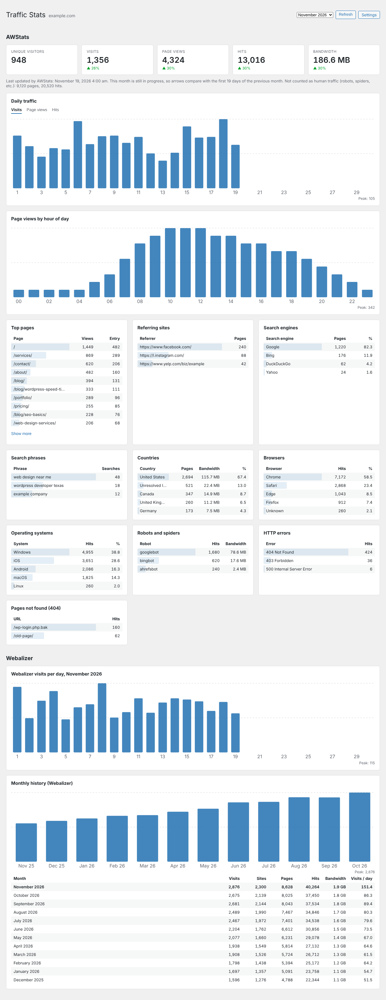
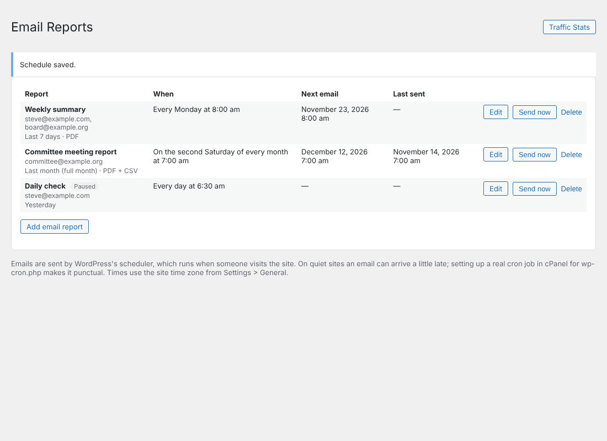

# cPanel Traffic Stats for WordPress

See your website traffic from cPanel's **AWStats** and **Webalizer** right inside the WordPress dashboard, with no tracking code, no cookies and no third-party service. The numbers come from your server's own access logs, the same ones cPanel already processes.



## Features

- Its own **Traffic Stats** menu in the WordPress admin sidebar, with **Report**, **Email Reports** and **Settings** underneath
- **Report** page with a month picker:
  - Unique visitors, visits, page views, hits and bandwidth, with change against the previous month (in-progress months are compared with the same number of days)
  - Daily traffic chart (visits / page views / hits) and page views by hour
  - Top pages, referring sites, search engines, search phrases, countries, browsers, operating systems, robots, HTTP errors and 404 URLs
  - Webalizer daily chart and 12-month history table
- **Dashboard widget** with this month's summary and a daily sparkline
- **Download reports as PDF or CSV** for the month you're viewing, a preset period (yesterday, last 7 days, last week, last 30 days, this month so far, last month) or any custom dates
- **Scheduled email reports** (Traffic Stats → Email Reports): send to any list of addresses
  - daily, weekly on chosen days, monthly on a date (or the last day), or monthly on a weekday such as *the second Saturday* or *the last Friday*
  - choose the send time, the period the report covers, and whether to attach the PDF, the CSV or both
  - the email itself shows the summary with changes and the top pages, referrers and search engines
  - pause, edit, delete, or **Send now** to test
- Two ways to get the data:
  - **Local files**: WordPress runs on the same cPanel account, so the plugin reads `~/tmp/awstats` and `~/tmp/webalizer` directly. The home folder is detected automatically.
  - **cPanel API token**: connects to any cPanel server over UAPI (`Fileman::list_files` / `Fileman::get_file_content`) so WordPress can live somewhere else.
- Combines HTTP and HTTPS stats (cPanel stores them separately), or shows either one
- Results are cached (default 60 minutes) with a **Refresh** button
- **Test connection** button on the settings page that tells you exactly what's wrong, and lists the domains that do have stats if yours isn't found
- API token stored encrypted (AES-256 with your site's salts)
- Choose who can see the stats (admins, editors, or authors)
- No JavaScript libraries or external requests; charts are inline SVG




See a [sample PDF report](docs/sample-report.pdf) made from the test data.

## Requirements

- WordPress 5.8+ and PHP 7.4+
- A cPanel hosting account with AWStats and/or Webalizer turned on (cPanel → **Metrics → Metrics Editor**). cPanel processes the logs about once a day.

## Installation

1. Download this repository as a ZIP (**Code → Download ZIP**) and upload it in **Plugins → Add New → Upload Plugin**, or copy the folder into `wp-content/plugins/cpanel-traffic-stats`.
2. Activate **cPanel Traffic Stats**.
3. Go to **Traffic Stats → Settings** in the admin menu, check the domain and choose a source (below).
4. Click **Run test**, then open **Traffic Stats → Report**.

### Option A: local files (same server)

If WordPress is installed in the cPanel account whose stats you want (for example `/home/username/public_html`), leave the source on **Read the stats files on this server**. The plugin finds `/home/username` automatically. If it can't (for example with `open_basedir` restrictions), enter the home folder yourself.

### Option B: cPanel API token (any server)

1. In cPanel, open **Security → Manage API Tokens** and create a token. Give it an expiry date if you like.
2. In the plugin settings choose **Connect to cPanel with an API token**, and enter:
   - **cPanel server**: the host you log in to cPanel with, without `https://` (e.g. `server.example.com` or `example.com`)
   - **Port**: `2083` (the default HTTPS cPanel port)
   - **cPanel username** and the **API token**
3. Save, then **Run test**.

The token gives full access to the cPanel account, so treat it like a password. The plugin only uses it to read files under `~/tmp/awstats` and `~/tmp/webalizer*`.

## Reports and scheduled emails

- Totals for any date range are added up from AWStats' (or Webalizer's) daily figures. Unique visitors only exist per month, so they appear for whole-month reports only.
- Each report compares with the period just before it: the previous 7 days, the previous month, and so on. A month still in progress is compared with the same days of the previous month.
- AWStats only keeps the top lists (pages, referrers, ...) per month, so a report covering part of a month shows that month's lists and says so.
- CSV files open directly in Excel or Google Sheets. Text that came from visitors (referrers, search phrases) is escaped so it can't run as a spreadsheet formula.
- Emails go out through `wp_mail()`, so an SMTP plugin is recommended if your host's mail is unreliable. WordPress's scheduler only runs when the site gets visits; for exact timing, turn off WP-Cron's page-load trigger and add a cPanel cron job for `wp-cron.php` (every 15 minutes is plenty).

## Where cPanel keeps the stats

| Program | HTTP | HTTPS |
| --- | --- | --- |
| AWStats | `~/tmp/awstats/awstatsMMYYYY.domain.txt` | `~/tmp/awstats/ssl/awstatsMMYYYY.domain.txt` |
| Webalizer | `~/tmp/webalizer/webalizer.hist`, `usage_YYYYMM.html` | `~/tmp/webalizerssl/…` |

On some hosts (Bluehost, for example) the main website's stats are filed under the account's built-in domain, such as `abc.xyz.mybluehost.me`, rather than your own domain. **Run test** lists the domains that have data and lets you switch with one click.

The plugin parses AWStats' data files directly (the same database AWStats uses to draw its own pages), and Webalizer's `webalizer.hist` monthly totals plus the daily table in `usage_YYYYMM.html`.

## Notes and limits

- When HTTP and HTTPS are combined, unique visitors are added together, so someone who visited over both counts twice. Visits, page views, hits and bandwidth add up correctly.
- AWStats counts robots separately; "page views" are human traffic only, the robots table and "not counted" line show the rest.
- Tables keep the top 100 rows of each list to keep the cache small.
- Stats are only as fresh as cPanel's last log run (shown on the report).

## Development

The parsers have no WordPress dependencies and come with sample data:

```sh
php tests/parser-test.php
```

`tests/fixtures/home` mimics a cPanel home folder, so you can also point the plugin's **cPanel home folder** setting at it on a local WordPress install to see the report with sample data.

### Filters

- `cts_view_capability` – change the capability needed to view stats.

## License

GPL-2.0-or-later. See [LICENSE](LICENSE).
